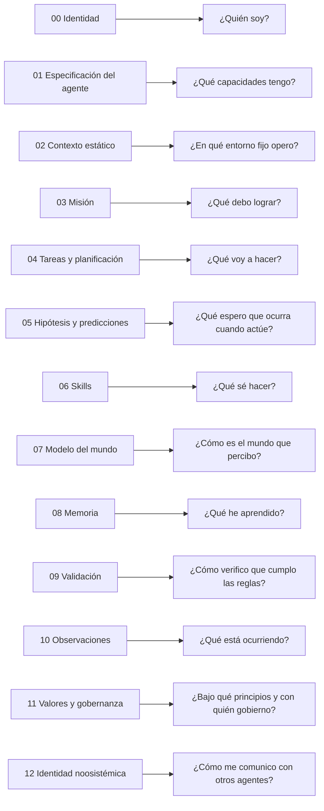
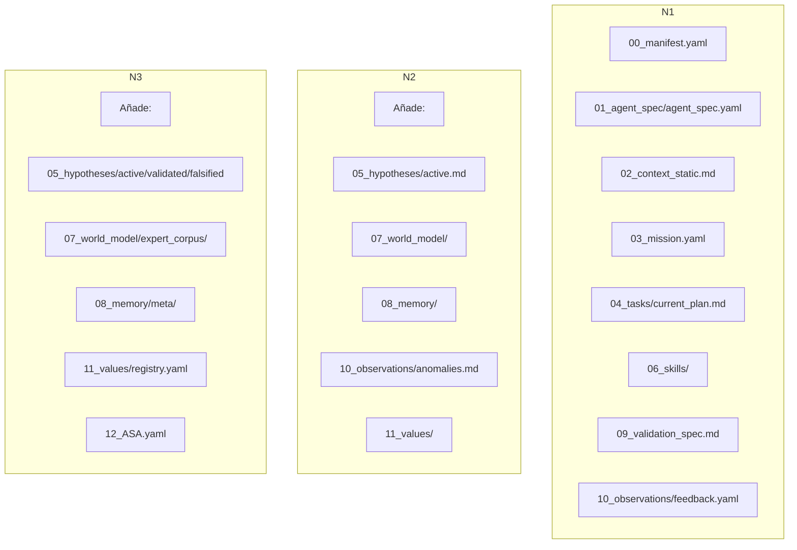
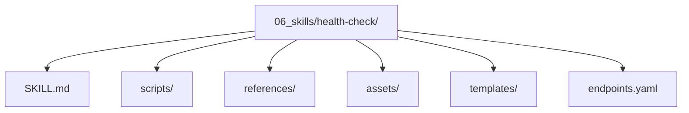
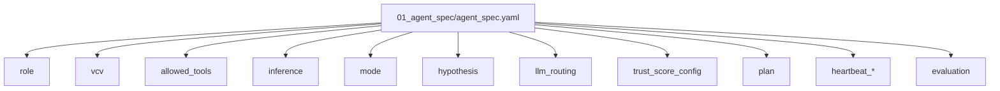
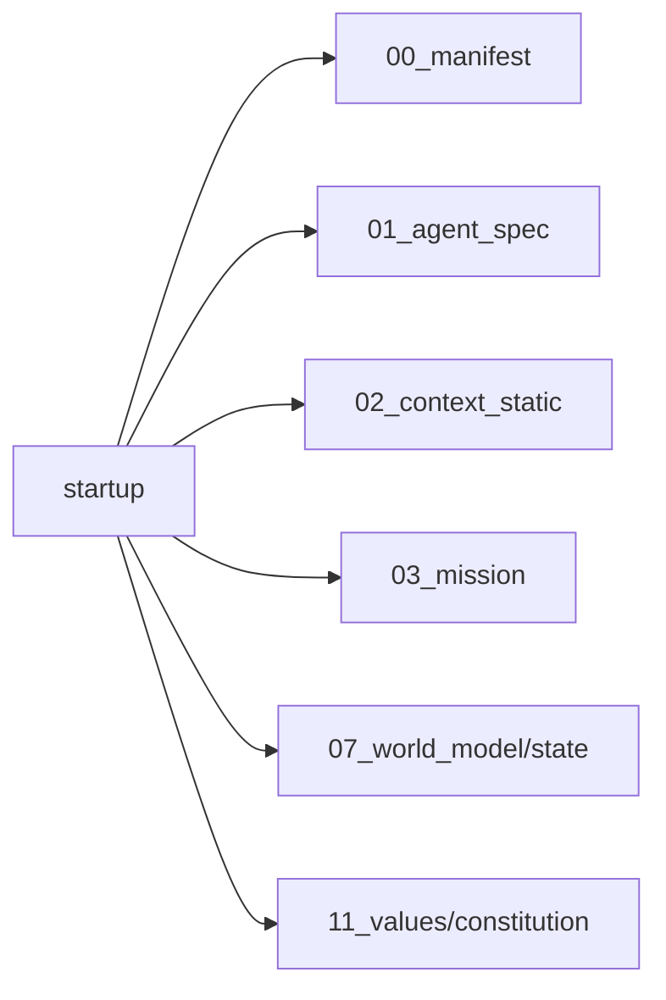
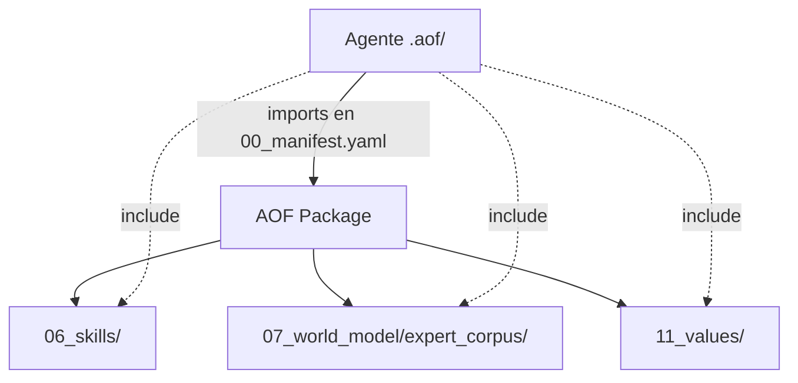

# Diagramas Conceptuales — AOF‑S

**Versión:** 1.6  
**Fecha:** 29 de agosto de 2026  
**Documento conceptual asociado:** `aofs-conceptual_es.md` v1.6  
**Naturaleza:** Ilustrativo. Ante cualquier discrepancia, prevalece `aof-s.yaml` v1.6.

---

## 1. Taxonomía de rangos cognitivos

> Referencia conceptual: `aofs-conceptual_es.md` v1.6, sección 4.2 — 29 de agosto de 2026

Cada rango agrupa artefactos que responden a una misma pregunta cognitiva. El orden es conceptual, no secuencial.

---

## 2. Estructura canónica del directorio `.aof/` por niveles

> Referencia conceptual: `aofs-conceptual_es.md` v1.6, secciones 5 y 6 — 29 de agosto de 2026

N1 proporciona la base. N2 añade hipótesis, mundo, memoria y gobernanza local. N3 completa el modelo con orquestación y comunicación noosistémica.

---

## 3. Estructura de una skill

> Referencia conceptual: `aofs-conceptual_es.md` v1.6, sección 8 — 29 de agosto de 2026

`SKILL.md` es el único archivo obligatorio. Los demás son opcionales. La skill es la unidad reutilizable de capacidad compatible con `agentskills.io`.

---

## 4. Especificación del agente y subartefactos

> Referencia conceptual: `aofs-conceptual_es.md` v1.6, sección 9 — 29 de agosto de 2026

El contrato central agrupa capacidades, restricciones, inferencia, planificación y confianza. En el futuro, subartefactos opcionales podrán residir en el mismo directorio.

---

## 5. Carga progresiva de contexto

> Referencia conceptual: `aofs-conceptual_es.md` v1.6, sección 13 — 29 de agosto de 2026

Solo se cargan los artefactos necesarios para la fase actual. La carga progresiva reduce el consumo de tokens y mantiene el foco cognitivo.

---

## 6. Importación de AOF Packages

> Referencia conceptual: `aofs-conceptual_es.md` v1.6, sección 11 — 29 de agosto de 2026

Un paquete reutiliza rangos completos mediante `imports`, con políticas de conflicto `merge`, `override` o `skip`. No puede modificar identidad ni especificación del agente.

---

**Documento ilustrativo.** Para dudas normativas, consultar `aof-s.yaml` v1.6.